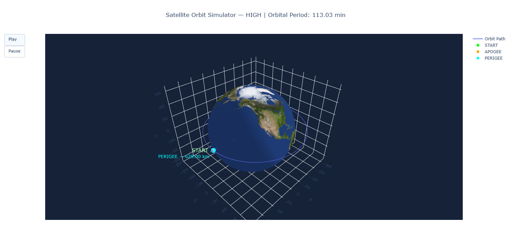

# Satellite Orbit Simulator

A Python project that simulates satellite motion around Earth using Newtonian gravity and the Velocity Verlet integration method.

The simulator provides an interactive 3D visualization of satellite orbits, supports different orbital configurations, and tracks energy conservation to evaluate numerical accuracy.

## Features

- **3D Orbit Visualization** — Interactive visualization of Earth, satellite trajectories, and orbital motion using Plotly.
- **Orbit Presets** — Choose between circular, elliptical, and high-altitude orbits.
- **Satellite Animation** — Animated satellite model with Play and Pause controls.
- **Orbital Calculations** — Calculate orbital periods, perigee, and apogee altitudes.
- **Energy Conservation Analysis** — Track relative energy error to evaluate the numerical simulation.
- **Dynamic Satellite Trail** — A yellow trail that grows behind the satellite during animation.
- **Physics Tests** — Automated tests using pytest.

## Preview



## How It Works

The simulator models satellite motion under Earth's gravitational force using Newton's law of universal gravitation.

Satellite positions and velocities are calculated using the **Velocity Verlet method**, a numerical integration technique that provides good energy conservation over time.

The simulation uses a fixed time step of one second. At each step, the satellite's position and velocity are updated based on its gravitational acceleration.

Orbital periods are calculated using **Kepler's Third Law**, while perigee and apogee altitudes are determined from the minimum and maximum distances between the satellite and Earth's center.

## Installation & Usage

**1. Clone the repository**

```bash
git clone https://github.com/liormaraykhin-tech/SatelliteOrbitSimulator.git
cd SatelliteOrbitSimulator
```

**2. Install dependencies**

```bash
python -m pip install -r requirements.txt
```

**3. Run the simulator**

```bash
python main.py
```

When prompted, select one of the available orbit types: `circular`, `elliptical`, or `high`.

The simulator calculates the orbital parameters and opens two interactive Plotly figures: a 3D orbital visualization and an energy conservation error graph.

## Credits

Earth texture: [Solar System Scope](https://www.solarsystemscope.com/textures/) — Earth Day Map.

Licensed under [Creative Commons Attribution 4.0 International (CC BY 4.0)](https://creativecommons.org/licenses/by/4.0/).

The texture is resized during rendering to match the 3D mesh resolution.